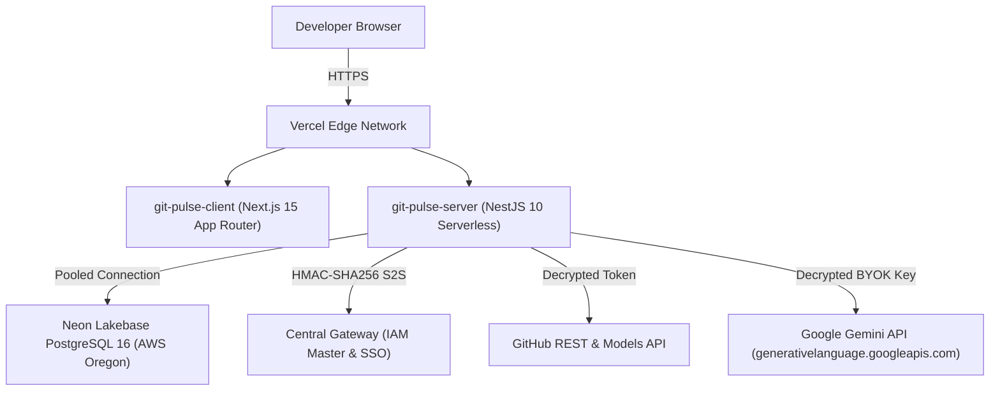

<div align="center">

# Git Pulse

**Developer Intelligence & Git Standup Workspace — part of the Prism Hub ecosystem.**

[](https://github.com/thanhba0505/git-pulse/actions/workflows/ci.yml)
[](https://github.com/thanhba0505/git-pulse/releases)
[](https://github.com/thanhba0505/git-pulse/releases)
[](https://git-pulse-app.vercel.app)
[](https://git-pulse-server.vercel.app/api/v1)
[](https://git-pulse-server.vercel.app/api/docs)
[](LICENSE)

[🌐 Developer Workspace](https://git-pulse-app.vercel.app) • [📑 Swagger OpenAPI](https://git-pulse-server.vercel.app/api/docs) • [🧭 Prism Hub Docs](https://github.com/thanhba0505/prism-hub/blob/main/docs/README.md) • [📖 Architecture Guide](https://github.com/thanhba0505/prism-hub/blob/main/docs/git-pulse/architecture.md) • [🚀 Deployment Guide](https://github.com/thanhba0505/prism-hub/blob/main/docs/git-pulse/deployment.md) • [🤖 AGENTS.md](https://github.com/thanhba0505/prism-hub/blob/main/AGENTS.md)

</div>

---

## 📌 Project Overview

**Git Pulse** aggregates daily GitHub pull requests and commits to synthesize concise standup reports using a **Personal BYOK AI Vault & Provider Console** (GitHub Models & per-user encrypted Google Gemini API keys with live model availability verification). Built with a clean Carbon-Slate precision UI and full bilingual (`vi` / `en`) support, it keeps engineering teams aligned with zero cognitive clutter.

### Core Capabilities:

- **Configurable AI Providers & Live Availability Checks**:
  - **GitHub Models**: Uses the user's active GitHub token with live endpoint & model availability probing.
  - **Personal Google Gemini (BYOK Vault)**: Each developer can connect their own Google AI Studio API key (`AIza...`), encrypted per-user with **AES-256-GCM + HKDF-SHA256**, automatically discovering live Gemini models (`Gemini 2.5 Flash`, `Gemini 2.5 Pro`, etc.) and probing runtime availability/quota before summarization.
- **Git Activity Scanner**: Fetches pull requests, commit timelines, and repository contributions across configurable time windows (`Today`, `24h`, `7d`).
- **Bilingual Workspace (`vi` / `en`)**: Full interface internationalization decoupled cleanly from AI report generation language.
- **Multi-Format Export Dock**: 1-click clipboard formatting for Parabol standups, Slack bullet lists, and plain bullets.
- **Central Gateway SSO & S2S**: Seamless single sign-on powered by Central Gateway with cryptographic HMAC-SHA256 signature verification.
- **Enterprise-Grade Token Security**: GitHub credentials encrypted at rest with **AES-256-GCM** using **Per-User HKDF Key Derivation**, backed by automated regex log sanitization.

---

## 🌌 Prism Hub Ecosystem

Git Pulse is a developer intelligence layer within the **Prism Hub** engineering ecosystem alongside its sister applications:

| Application         | Role & Mission                                        | Standard Local Port | Live Production                                            | Interactive Docs                                                      |
| :------------------ | :---------------------------------------------------- | :-----------------: | :--------------------------------------------------------- | :-------------------------------------------------------------------- |
| **Git Pulse**       | Developer Intelligence & AI Standup Workspace         |   `6100` / `6101`   | [Developer Workspace](https://git-pulse-app.vercel.app)    | [Swagger OpenAPI](https://git-pulse-server.vercel.app/api/docs)       |
| **Wonderlab**       | Interactive Science, Probability & Paradox Laboratory |   `4100` / `4101`   | [Live Experience](https://wonderlab.io.vn)                 | [Swagger OpenAPI](https://wonderlab-server.vercel.app/api/docs)       |
| **Central Gateway** | Centralized IAM Master, OAuth2 SSO & Notification Hub |   `5100` / `5101`   | [Control Plane](https://central-gateway-client.vercel.app) | [Swagger OpenAPI](https://central-gateway-server.vercel.app/api/docs) |

> All services share PostgreSQL 16 on local port `5432` during development and connect to serverless Neon Lakebase PostgreSQL in production.

---

## 🏗️ System Architecture



---

## 📦 Monorepo Structure

```text
git-pulse/
├── client/          # Next.js 15 App Router, React 19, Tailwind CSS
├── server/          # NestJS 10 REST API, Prisma ORM, AES-256-GCM Token & AI Key Vault
├── .github/         # Parallel CI/CD workflows, release automation, PR & issue templates
└── scripts/         # Automated release version synchronization and verification scripts
```

> Architectural documentation, API contracts, AI rules (`AGENTS.md`), and shared local Docker PostgreSQL orchestration are centralized in [`thanhba0505/prism-hub`](https://github.com/thanhba0505/prism-hub).

| Workspace    | Technology Stack                              | Local Port | Role & Responsibility                                                      |
| :----------- | :-------------------------------------------- | :--------: | :------------------------------------------------------------------------- |
| **`client`** | Next.js 15 App Router, React 19, Tailwind CSS |   `6100`   | Precision Carbon-Slate workspace, i18n, AI provider selector, export dock. |
| **`server`** | NestJS 10, Prisma ORM, AES-256-GCM Vault      |   `6101`   | REST API (`/api/v1`), token/AI-key encryption, AI proxy, and S2S auth.     |

---

## 🚀 Getting Started

### Prerequisites

- **Node.js**: `v24.x` (enforced via `.nvmrc`)
- **Package Manager**: `pnpm` `12.11.2` (`npm i -g pnpm@12.11.2`)
- **PostgreSQL 16**: Running on `127.0.0.1:5432` (managed centrally via Docker Compose in `prism-hub` or native local Postgres)

### 1. Recommended Setup via Prism Hub

```bash
git clone https://github.com/thanhba0505/prism-hub.git
cd prism-hub
make init              # Starts shared PostgreSQL (127.0.0.1:5432), installs deps & syncs DBs
make git-pulse-start   # Starts Git Pulse client (6100) + server (6101)
```

### 2. Standalone Usage (Requires PostgreSQL 16 on `127.0.0.1:5432` with `git_pulse` DB)

```bash
git clone https://github.com/thanhba0505/git-pulse.git
cd git-pulse
cp .env.example .env.local
pnpm install
pnpm dev               # Client on 6100 + Server on 6101
```

Or run individually:

- `pnpm dev:client` — Next.js Client on port `6100`
- `pnpm dev:server` — NestJS Server on port `6101`

### 3. Verification & Testing

```bash
pnpm check          # Verification pipeline: Format -> Lint -> Typecheck -> Unit Tests
pnpm build          # Production build (server + client)
pnpm test           # Run Jest unit test suites
pnpm lint           # ESLint validation with 0 warnings policy
pnpm format:check   # Prettier code formatting check
```

---

## 📑 Technical Documentation Index

All technical guides, security specs, and AI coding guidelines have moved to the central **[Prism Hub](https://github.com/thanhba0505/prism-hub)** repository:

- [Prism Hub Documentation Hub](https://github.com/thanhba0505/prism-hub/blob/main/docs/README.md)
- [Unified AGENTS.md & Contributing Guide](https://github.com/thanhba0505/prism-hub/blob/main/AGENTS.md)
- [System Architecture & Dual-Engine AI](https://github.com/thanhba0505/prism-hub/blob/main/docs/git-pulse/architecture.md)
- [API Reference & REST Contracts](https://github.com/thanhba0505/prism-hub/blob/main/docs/git-pulse/api-reference.md)
- [Security & Token Encryption Architecture](https://github.com/thanhba0505/prism-hub/blob/main/docs/git-pulse/security.md)
- [Deployment & Vercel Serverless Operations](https://github.com/thanhba0505/prism-hub/blob/main/docs/git-pulse/deployment.md)
- [Shared Database & Neon Safety Guide](https://github.com/thanhba0505/prism-hub/blob/main/docs/shared/database.md)

---

## 📄 License

Licensed under the [MIT License](LICENSE) © 2026 **thanhba0505**.
