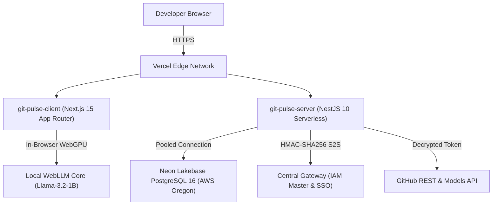

<div align="center">

# Git Pulse

**Developer Intelligence & Git Workspace with Dual-Core AI and Activity Radar — part of the Prism Hub ecosystem.**

[](https://github.com/thanhba0505/git-pulse/actions/workflows/ci.yml)
[](https://github.com/thanhba0505/git-pulse/releases)
[](https://github.com/thanhba0505/git-pulse/releases)
[](https://git-pulse-app.vercel.app)
[](https://git-pulse-server.vercel.app/api/v1)
[](https://git-pulse-server.vercel.app/api/docs)
[](LICENSE)

[🌐 Developer Workspace](https://git-pulse-app.vercel.app) • [📑 Swagger OpenAPI](https://git-pulse-server.vercel.app/api/docs) • [📖 Architecture Guide](docs/architecture.md) • [🚀 Deployment Guide](docs/deployment.md) • [📋 Contributing Guide](CONTRIBUTING.md)

</div>

---

## 📌 Project Overview

**Git Pulse** aggregates daily GitHub pull requests, commits, and issue activities to synthesize high-precision standup reports using an innovative **Dual-Core AI** engine. It visualizes developer momentum through cosmic radar HUDs and real-time pulsar waveforms, keeping engineering teams aligned with zero cognitive friction.

### Core Capabilities:

- **Dual-Core AI Synthesis (Zero Server Cost)**:
  - **Warp-Drive Core (Cloud AI)**: Dispatches inference calls to GitHub Models (Azure Inference) directly using the user's decrypted GitHub token (`gpt-4o-mini`, `meta-llama-3.3-70b-instruct`).
  - **Sub-Light Core (In-Browser WebGPU)**: Runs quantized models (`Llama-3.2-1B`, `Qwen2.5-Coder-1.5B`) directly inside the developer's browser via WebGPU using `@mlc-ai/web-llm` — 100% private, offline, and zero API quota consumed.
- **Developer Radar & Activity Scanner**: Live sonar radar mapping commit frequency, open PRs, and repository contributions across time windows.
- **Live Pulsar Waveform**: Oscillating visualizer reflecting coding rhythm and velocity.
- **Multi-Format Export Dock**: 1-click clipboard formatting for Parabol standups, Slack bullet lists, Markdown tables, and Jira tickets.
- **Central Gateway SSO & S2S**: Seamless single sign-on powered by Central Gateway with cryptographic HMAC-SHA256 signature verification.
- **Enterprise-Grade Token Security**: GitHub credentials encrypted at rest with **AES-256-GCM** using **Per-User HKDF Key Derivation**, backed by automated regex log sanitization.

---

## 🌌 Prism Hub Ecosystem

Git Pulse is a developer intelligence layer within the **Prism Hub** engineering ecosystem alongside its sister applications:

| Application         | Role & Mission                                        | Standard Local Port | Live Production                                            | Interactive Docs                                                      |
| :------------------ | :---------------------------------------------------- | :-----------------: | :--------------------------------------------------------- | :-------------------------------------------------------------------- |
| **Git Pulse**       | Developer Intelligence, Dual-Core AI & Activity Radar |   `6100` / `6101`   | [Developer Workspace](https://git-pulse-app.vercel.app)    | [Swagger OpenAPI](https://git-pulse-server.vercel.app/api/docs)       |
| **Wonderlab**       | Interactive Science, Probability & Paradox Laboratory |   `4100` / `4101`   | [Live Experience](https://wonderlab.io.vn)                 | [Swagger OpenAPI](https://wonderlab-server.vercel.app/api/docs)       |
| **Central Gateway** | Centralized IAM Master, OAuth2 SSO & Notification Hub |   `5100` / `5101`   | [Control Plane](https://central-gateway-client.vercel.app) | [Swagger OpenAPI](https://central-gateway-server.vercel.app/api/docs) |

> All services share PostgreSQL 16 on local port `5432` during development and connect to serverless Neon Lakebase PostgreSQL in production.

---

## 🏗️ System Architecture



---

## 📦 Monorepo Structure

```text
git-pulse/
├── client/          # Next.js 15 App Router, React 19, Tailwind CSS v4, WebLLM
├── server/          # NestJS 10 REST API, Prisma ORM, AES-256-GCM Token Vault
├── docs/            # Architecture specifications, deployment, and security guides
├── .github/         # Parallel CI/CD workflows, release automation, PR & issue templates
└── scripts/         # Automated release version synchronization and verification scripts
```

| Workspace    | Technology Stack                                      | Local Port | Role & Responsibility                                                      |
| :----------- | :---------------------------------------------------- | :--------: | :------------------------------------------------------------------------- |
| **`client`** | Next.js 15 App Router, React 19, WebLLM, Tailwind CSS |   `6100`   | Radar HUD cockpit, WebGPU local AI synthesizer, and standup export dock.   |
| **`server`** | NestJS 10, Prisma ORM, AES-256-GCM Vault              |   `6101`   | REST API (`/api/v1`), token encryption, GitHub Models proxy, and S2S auth. |

---

## 🚀 Getting Started

### Prerequisites

- **Node.js**: `v24.x` (enforced via `.nvmrc`)
- **Package Manager**: `pnpm` `12.11.2` (`npm i -g pnpm@12.11.2`)
- **Docker**: For local PostgreSQL 16 container (`127.0.0.1:5432`)

### 1. Clone & Install Dependencies

```bash
git clone https://github.com/thanhba0505/git-pulse.git
cd git-pulse
cp .env.example .env.local
pnpm install
```

### 2. Start Local PostgreSQL Database

```bash
docker compose up -d postgres
```

_(PostgreSQL securely binds to loopback `127.0.0.1:5432` with database `git_pulse`)_

### 3. Run Development Servers

```bash
# Start both Client and Server concurrently:
pnpm dev

# Or run services individually:
pnpm dev:client   # Next.js Client on port 6100
pnpm dev:server   # NestJS Server on port 6101
```

### 4. Verification & Testing

```bash
pnpm check          # Full pipeline: Format -> Lint -> Typecheck -> Unit Tests -> Build
pnpm test           # Run Jest unit test suites
pnpm lint           # ESLint validation with 0 warnings policy
pnpm format:check   # Prettier code formatting check
```

---

## 📑 Technical Documentation Index

Explore in-depth technical guides in `docs/`:

- [System Architecture](docs/architecture.md)
- [Deployment & Vercel Serverless Operations](docs/deployment.md)
- [API Reference & REST Contracts](docs/api-reference.md)
- [Security & Token Encryption Architecture](docs/security.md)

---

## 📄 License

Licensed under the [MIT License](LICENSE) © 2026 **Bá Lê Thanh** (thanhba0505).
