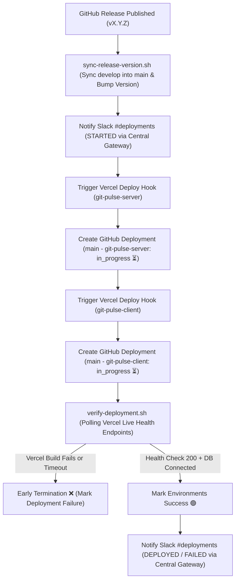

# Git Pulse Deployment Architecture & Operations Guide

Production deployments in **Git Pulse** are fully automated, monitored, and orchestrated across GitHub Actions, Vercel Serverless Deploy Hooks, Neon Lakebase PostgreSQL, and Slack notifications.

---

## 1. High-Level Rollout Architecture

Production deployment is triggered exclusively by publishing an official GitHub Release (`v*.*.*`) or pushing a matching tag.



---

## 2. Infrastructure Specifications

### 1. `git-pulse-client` (Frontend)

- **Platform**: Vercel (`git-pulse-client`)
- **Framework**: Next.js 15 (App Router), React 19
- **Production URL**: `https://git-pulse-app.vercel.app`
- **Aliases**: `https://git-pulse-web.vercel.app`, `https://git-pulse-client-eta.vercel.app`
- **Health Check**: `https://git-pulse-app.vercel.app/health`
- **Environment Variables**:
  - `NEXT_PUBLIC_API_URL`: `https://git-pulse-server.vercel.app/api/v1`
  - `NEXT_PUBLIC_GATEWAY_CLIENT_URL`: `https://central-gateway-client.vercel.app`
  - `NODE_ENV`: `production`

### 2. `git-pulse-server` (Backend API)

- **Platform**: Vercel Serverless Functions (`git-pulse-server`)
- **Framework**: NestJS 10 REST API via Express Serverless Adapter (`server/api/index.ts`)
- **Region**: `iad1` (Washington, D.C.)
- **Production URL**: `https://git-pulse-server.vercel.app/api/v1`
- **OpenAPI Swagger**: `https://git-pulse-server.vercel.app/api/docs`
- **Health Check**: `https://git-pulse-server.vercel.app/api/v1/health`
- **Environment Variables**:
  - `DATABASE_URL`: Neon Lakebase PostgreSQL connection pooler
  - `JWT_SECRET`: High-entropy 256-bit token signing secret
  - `GITHUB_TOKEN_ENCRYPTION_KEY`: 256-bit hex master key for AES-256-GCM + HKDF derivation
  - `S2S_ENCRYPTION_KEY`: 256-bit hex key for S2S Vault encryption at rest
  - `GATEWAY_URL`: `https://central-gateway-server.vercel.app/api/v1`
  - `CORS_ORIGIN`: Whitelist of trusted frontend domains

### 3. Production Database

- **Platform**: **Neon Serverless PostgreSQL 16** (AWS Oregon `us-west-2`)
- **Connection Model**: PgBouncer Pooled connection string (`channel_binding=require`)
- **Automated Migration Protocol**:
  - Strictly forbids manual migrations against remote Neon from developer machines.
  - Server build script executes migrations automatically on release:
    ```bash
    prisma generate && (if [ -n "$DATABASE_URL" ]; then prisma migrate deploy; fi) && nest build
    ```

---

## 3. Real-Time GitHub Deployments

Rather than a single opaque commit status, Git Pulse tracks deployment progress granularly in GitHub's environment interface:

1. **`main - git-pulse-server`**:
   - Initialized as `in_progress` with an active loading spinner ⏳ as soon as deployment is invoked.
   - Points to `https://git-pulse-server.vercel.app/api/v1/health`.
   - Transitions to `success` 🟢 once backend health verifies database connectivity (`SELECT 1`).

2. **`main - git-pulse-client`**:
   - Initialized as `in_progress` ⏳ concurrently with frontend build queue.
   - Points to `https://git-pulse-app.vercel.app`.
   - Transitions to `success` 🟢 once Next.js static and serverless routes respond with HTTP 200.

---

## 4. Automated Verification (`scripts/verify-deployment.sh`)

The verification script polls production health probes with built-in fail-fast resilience:

```bash
./scripts/verify-deployment.sh \
  --service all \
  --version "0.3.1" \
  --gh-repo "thanhba0505/git-pulse" \
  --timeout 600 \
  --interval 10 \
  --initial-delay 15
```

- **Rollout Guard**: Enforces a minimum 20s warm-up pause (`MIN_ROLLOUT_WAIT`) to prevent false-positive matches on pre-existing versions.
- **Deep Health Assertion**: Confirms that both version and database status (`database: "connected"`) match before declaring success.
- **Auto GitHub Sync**: Directly updates the corresponding GitHub Deployment status IDs to `success` or `failure`.
